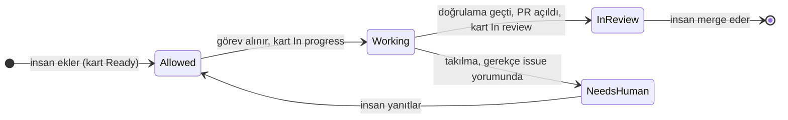

# IssuePilot

Issue, CI/CD hatası ve dokümantasyon eksiklerini inceleyip doğrulanmış PR hazırlamak için bağımsız proje.

Durum: GitHub üzerindeki mevcut issue okunabilir ve etiket uygunluğu kontrol edilir. Gemini ile belge ve küçük kod düzeltmesi üretme, durum etiketleri, PR açma ve yarıda kalan işi kurtarma akışı uygulanmıştır; dört pilot görev çalıştırılmıştır (üçü merge edildi, biri incelemede). Henüz yoktur: workflow'da kuyruktan görev seçimi (salt okunur `queue` komutu vardır), issue yorumlarını okuma, workflow'a bağlı CI hata analizi (yerel `classify-log` komutu vardır), otomatik Done geçişi.

## Çalıştırma

Node.js 24 LTS ve npm gerekir. GitHub Actions ilk otomasyon ortamı olacaktır.


```sh
npm ci
npm run build
npm start -- --help
```

İlk hedef: `Agent::Allowed` etiketli issue → analiz → izole çalışma dalı → değişiklik → doğrulama → PR. Merge kararı insandadır.



Sonraki aşamalar CI hata analizi ve kodla karşılaştırmalı dokümantasyon denetimidir.

- [Etiket protokolü](docs/label-protocol.md)
- [Uygulama planı](docs/implementation-plan.md)

Repo: https://github.com/mustafasercansak/issuepilot (public). Lisans: [MIT](LICENSE).

İlk pilot görevi: [repo envanteri](docs/first-issue.md). GitHub issue şablonu repoya eklenmiştir; AI envanter otomasyonu varsayılan olarak kapalıdır.

## GitHub issue okuma

```sh
npm start -- issue OWNER/REPO 123
```

Komut GitHub REST API üzerinden mevcut issue başlığını, açıklamasını ve etiketlerini okuyup JSON döndürür. Public repolar için token zorunlu değildir. Private repolarda gerekli issue okuma yetkisine sahip `GH_TOKEN` veya `GITHUB_TOKEN` ortam değişkenini kullanın.

Açık issue üzerinde `Agent::Allowed` ve yapılandırılmış Projects panosunda `Status = Ready` gerekir. `PROJECT_ID` ve `PROJECT_TOKEN` olmadan uygunluk verilmez. `Rejected`, `Working` ve `In-Review` işlemeyi engeller; PR kayıtları kabul edilmez. Needs-Human sonrasında insanın yeniden Allowed eklemesi uygunluğu geri açar. Bu kontrol salt okunurdur, görevi sahiplenmez ve eşzamanlı çalışmayı kilitlemez.

Çıkış kodları: 0 uygun, 1 uygun değil, 2 kullanım/API/bağlantı hatası.

Issue yorumları henüz okunmaz. Envanter AI job’ı ayrıca yapılandırılıp etkinleştirilir. `Agent::Allowed` eklendiğinde Issue intake workflow’u salt okunur uygunluk kontrolünü çalıştırır. Manuel çalıştırma da desteklenir. Workflow kuyruktan görev seçmez; tek onaylı issue (`INVENTORY_ISSUE_NUMBER`) işlenir.

## Kuyruk (salt okunur)

```sh
npm start -- queue OWNER/REPO
```

Açık, `Agent::Allowed` etiketli ve Projects panosunda `Status = Ready` olan issue'ları eskiden yeniye sıralar; `Next` sıradaki görevdir, `Skipped` her elenen issue'nun nedenini verir. `PROJECT_ID` ve `PROJECT_TOKEN` zorunludur; eksikse veya pano okunamazsa komut hata verir. Komut hiçbir etiketi veya kartı değiştirmez ve görevi sahiplenmez. Henüz workflow'a bağlı değildir. Çıkış kodları: 0 sıradaki var, 1 kuyruk boş, 2 hata.

## CI log sınıflandırma (yerel)

```sh
npm start -- classify-log ci.log
gh run view RUN_ID --log-failed | npm start -- classify-log -
```

Elinizdeki bir CI logunu `permissions`, `dependency`, `build`, `test`, `timeout`, `infrastructure` veya `unknown` olarak sınıflandırır; ilk eşleşen kategori `category`, eşleşen tümü `matched`, yeniden denemenin mantıklı olup olmadığı `retryable` alanındadır (yalnızca `timeout` ve `infrastructure`). `evidence` en fazla beş kısaltılmış satırdır; bilinen token biçimleri maskelenir ama bu genel bir secret tarayıcısı değildir. Sınıflandırma kural tabanlı bir sezgidir ve nedenin kesin kanıtı sayılmamalıdır. Komut log indirmez, issue açmaz, hiçbir şeyi değiştirmez. Çıkış kodları: 0 sınıflandı, 1 bilinmiyor, 2 okunamadı veya 5 MB üstü.

## Kontroller

```sh
npm test
```

Doğrudan JSON çıktısı için `node dist/cli.js issue OWNER/REPO 123` kullanın.

AI bağlantısının hedef akışı ve mevcut sınırlar: [AI workflow](docs/ai-workflow.md).

Ready kapısı ve pano erişimi: [kurulum](docs/ready-gate.md). Yalnızca Ready’ye taşıma, tarama açıkken 30 dakikalık kontrolde algılanır; Allowed etiket olayı hemen kontrol başlatır.

Ajan AI çağrısından önce kartı **In progress**, PR açıldığında **In review** yapar. PROJECT_TOKEN için `project` yazma yetkisi gerekir. Takılma durumu issue üzerinde Needs-Human ve açıklama yorumuyla gösterilir.

## Yarıda kalan işler

Kaydedilmiş belge ve açık PR doğrulanarak yeniden kullanılır; aynı belge için model çağrısı veya PR kopyası oluşturulmaz. GitHub kaynaklı geçici hatalarda bir kez toparlama denenir. Kesilmiş Working işleri manuel resume_working seçeneğiyle devam ettirilebilir. [Kurallar ve sınırlar](docs/recovery.md).

## GitHub Actions ile ilk görev

GitHub Actions, projenin otomasyon merkezi olarak yapılandırılmıştır. İlk kurulum ve iş akışı yönetimi için Node.js 24 LTS sürümü kullanılır. İş akışlarını çalıştırmak için ilgili dizinlerde şu komutlar sırayla uygulanmalıdır:

```sh
npm ci
npm run build
npm test
npm start -- --help
```

### Kurulum ve Yetkilendirme

Projenin envanter ve AI işlemlerini yürütebilmesi için aşağıdaki GitHub Secret ve Variable tanımlarının yapılması gerekir:

*   **Secret'lar:** `GEMINI_API_KEY` (AI modeline erişim için) ve `PROJECT_TOKEN` (GitHub Project panosunu okumak ve güncellemek için gereklidir).
*   **Variable'lar:** `PROJECT_ID`, `INVENTORY_ISSUE_NUMBER` (işlenecek hedef issue numarası), `INVENTORY_AI_ENABLED` (AI otomasyonunu aktif etmek için `true` yapılmalıdır) ve `PROJECT_POLLING_ENABLED` (Ready durumundaki issue'ları periyodik kontrol etmek için `true` seçilebilir).

İş akışı `contents: write`, `issues: write` ve `pull-requests: write` izinlerine ihtiyaç duyar; bu yetkiler PR oluşturulması ve etiket yönetimi için zorunludur.

### İş Akışı Kontrolleri

İş akışı iki farklı tetikleyici ile çalışır:
1.  **Anlık Kontrol:** Issue üzerinde `Agent::Allowed` etiketi eklendiğinde, workflow anında uygunluk denetimi yapar.
2.  **Periyodik Kontrol:** `PROJECT_POLLING_ENABLED` aktif ise, her 30 dakikada bir "Ready" durumundaki issue'lar taranır.

**Ready kapısı** (detaylar için [docs/ready-gate.md](docs/ready-gate.md)) kuralına göre, görevin başlaması için kartın `Status = Ready` olması ve issue üzerinde `Agent::Allowed` etiketinin bulunması gerekir. Çalışma başladıktan sonra süreç şu şekilde ilerler:

*   **In progress:** Ajan AI çağrısından önce kartı bu duruma getirir.
*   **In review:** PR başarıyla açıldığında kart bu duruma taşınır.

AI süreçleri ve envanter oluşturma adımları hakkında detaylı bilgi için [docs/ai-workflow.md](docs/ai-workflow.md), yapılan işlemlerin kayıtları için ise [docs/issue-journal.md](docs/issue-journal.md) dosyalarını inceleyebilirsiniz. Bu sistem, belirli yapılandırılmış görevleri işlemek üzere tasarlanmıştır; genel bir kod ajanı veya sınırsız kuyruk yönetimi sağlamaz.

Bu akış yapılandırılmış tek görevi işler; genel kuyruk değildir.

